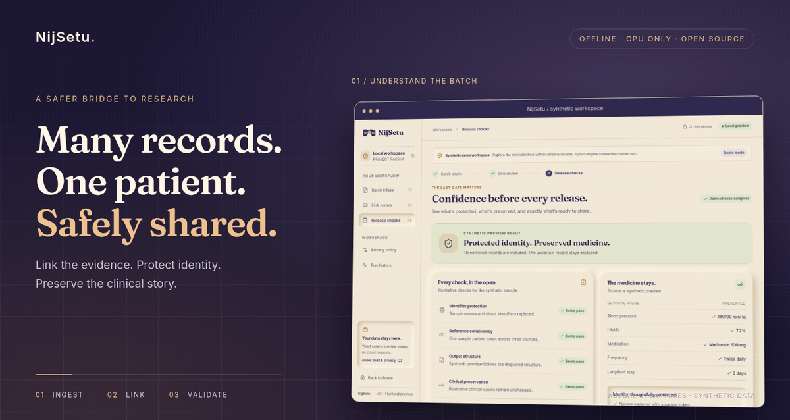
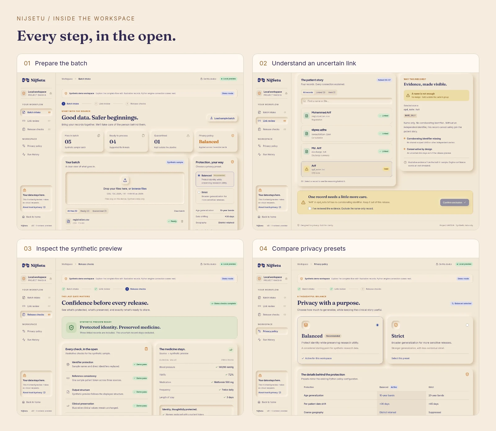
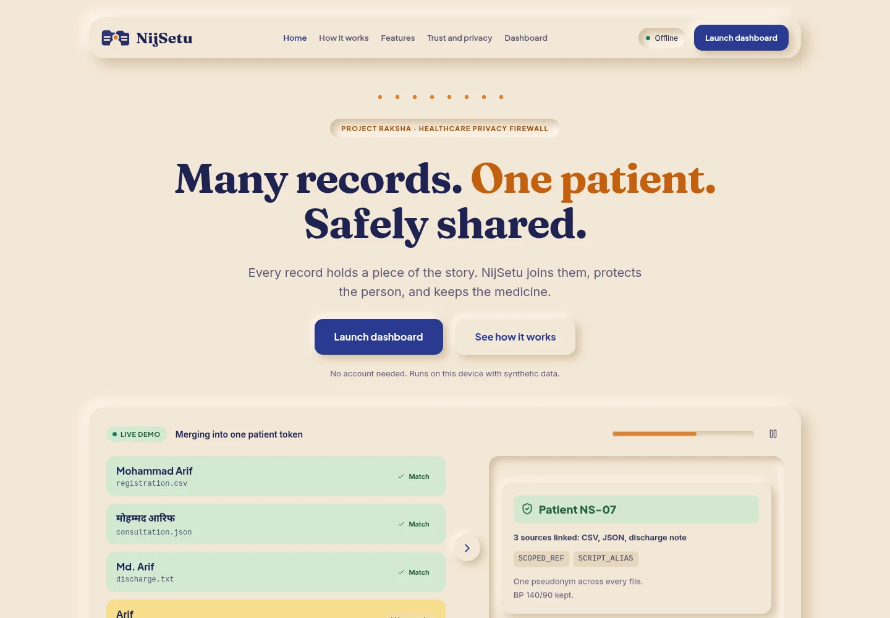
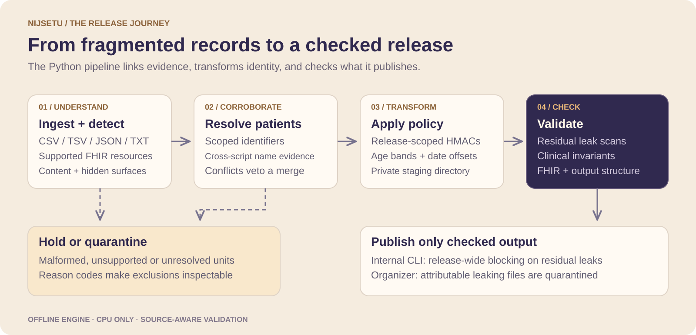
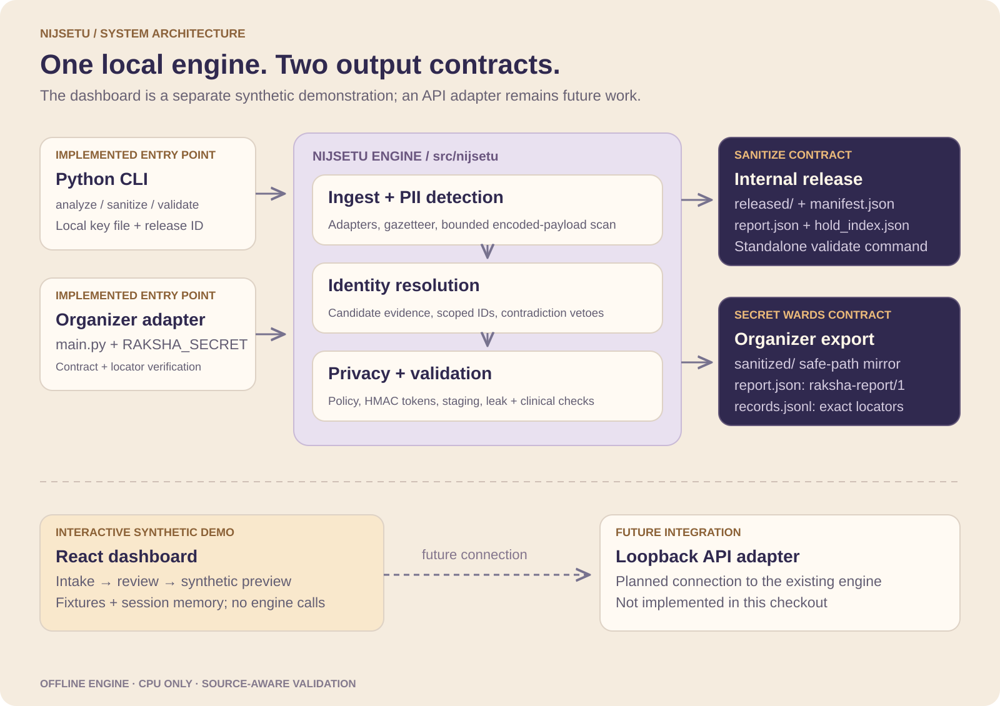

<div align="center">

<a href="#see-it-in-action"><picture><source media="(prefers-reduced-motion: reduce)" srcset="docs/assets/readme/hero-poster.webp"></picture></a>

# NijSetu

### Many records. One patient. Safely shared.

**An offline bridge from fragmented clinical records to privacy-protected research data.**

NijSetu detects identifying information, links corroborated patient records across formats and scripts, and produces checked, release-specific pseudonymous exports while preserving clinical meaning.


[](LICENSE)

[Watch the demo](#see-it-in-action) · [Workflow](#from-records-to-release) · [Architecture](#architecture) · [Run locally](#run-it-locally) · [Evidence](#verification-and-evidence)

<sub>Project RAKSHA · Secret Wards · Local processing · English, Hindi and Hinglish detection</sub>

</div>

---

## Protect the person. Keep the medicine.

A registration sheet, a discharge note and a lab export may describe the same person using different names, scripts and identifiers. Removing those identifiers without understanding the connections can break the patient story. Retaining them can expose the patient.

NijSetu separates **identity evidence**, **privacy transformations** and **clinical checks**. It links records when evidence agrees, abstains when the evidence is insufficient, and records holds rather than silently discarding difficult inputs.

| Need | What NijSetu provides |
|---|---|
| Recognize identifying information | Structured-field and free-text detection, cross-script normalization, and checks on filenames, metadata, headers, keys and bounded Base64 payloads. |
| Keep one patient's records connected | Scoped identifiers, explainable name evidence, cluster-level contradiction checks and consistent release-scoped tokens. |
| Preserve useful medicine | Checks on recognized measurements, medications, history and temporal intervals during sanitization. |
| Inspect what was excluded | Explicit reason codes, quarantine accounting and reports tied to published output. |
| Work without cloud services | A CPU-only Python engine with one mandatory dependency (`cryptography`, for encryption at rest) and no external model calls. |
| Protect raw/private files at rest | Uploaded raw data and the private analysis artifact are AES-256-GCM ciphertext on disk, never plaintext -- see [Encryption at rest](#encryption-at-rest). |

**Current implementation:** the React dashboard is connected to the Python engine through a local HTTP API. Judges can run the bundled demo or upload CSV, TSV, JSON/FHIR, TXT, folders or ZIP datasets. Review, policy selection, release checks, history and ZIP downloads use real engine results. Start everything with `bash scripts/start-dashboard.sh` and open **http://127.0.0.1:8765**.

## See it in action

<a href="docs/assets/readme/product-tour.mp4"><picture><source media="(prefers-reduced-motion: reduce)" srcset="docs/assets/readme/release.webp"></picture></a>

<p align="center"><sub>Historical browser capture of the earlier frontend demo, using synthetic fixtures. The GIF is accelerated; the 34-second MP4 plays at the recorded speed. This recording predates the engine integration; the current dashboard runs actual engine checks.</sub></p>

<p align="center"><b><a href="docs/assets/readme/product-tour.mp4">▶ Watch the full recording</a></b> · <a href="docs/assets/readme/capture-manifest.json">Capture record</a> · <a href="docs/assets/readme/hero-poster.webp">Static cover</a></p>

### Inside the workspace

These screenshots show the earlier demo interface. The current integrated workflow and start command are documented below.



| Screen | What to look for |
|---|---|
| [Batch intake](docs/assets/readme/intake.webp) | Five sample files, four supported-format labels, one quarantined PDF, and a policy choice. |
| [Link evidence](docs/assets/readme/review-linked.webp) | Three illustrative source records linked into one sample patient group. |
| [Held-record review](docs/assets/readme/review-held.webp) | A name-only record stays outside the group; exclusion requires an explicit acknowledgement. |
| [Locked release](docs/assets/readme/release-locked.webp) → [Reviewed release](docs/assets/readme/release.webp) | Download becomes available only after the sample run and review are complete. |
| [Privacy policy](docs/assets/readme/policy.webp) | Balanced and strict presets; changing policy invalidates the current sample run. |
| [Run history](docs/assets/readme/history.webp) | Session-level summaries; refreshing the page clears the demo state. |

<details>
<summary><b>Explore the landing page and full release view</b></summary>
<br>



[Full landing page](docs/assets/readme/landing-full.webp) · [Full release page](docs/assets/readme/release-full.webp) · [Frontend guide](frontend/README.md)

</details>

## From records to release



1. **Understand the batch.** Parse supported files, normalize field aliases, and detect identifying content across visible and hidden surfaces.
2. **Corroborate identity.** Combine scoped identifiers and cross-script name evidence. Conflicting birth years, phones, identifier series or same-role relatives can veto a merge.
3. **Transform consistently.** Derive release-specific HMAC tokens, apply one date offset per patient, generalize age and geography, and rewrite supported FHIR identifiers and references together.
4. **Check before publication.** Reparse staged output, check recognized clinical invariants and references, scan for residual identifiers, and reconcile released and held units.
5. **Publish the checked result.** The internal CLI promotes validated staging atomically. The organizer adapter shapes that result into the submission contract and verifies record-specific pseudonym claims.

The internal `sanitize` path blocks the whole release on a residual leak. In organizer mode, an attributable leaking file is quarantined and the remaining output is rescanned; an unattributable residual finding still blocks the run. These are distinct, implemented contracts.

### Privacy choices you can inspect

| Policy setting | Balanced | Strict |
|---|---|---|
| Per-patient date-offset range | −30 to +30 days | −45 to +45 days |
| Age bands | 10 years; top band starts at 90 | 20 years; top band starts at 80 |
| Coarse geography | District-level policy, subject to risk escalation | Suppressed |
| Small-group review threshold | 3 distinct patients | 5 distinct patients |
| Provider and facility names | Retained by default | Suppressed |

Patient and relative names are masked; contact information and fine addresses are suppressed. National identifiers are masked, while eligible local identifiers are tokenized. Risk escalation can generalize or suppress additional fields.

The thresholds guide release-level risk handling; they are **not a guarantee of anonymity**. [Policy source](src/nijsetu/phase2/policy.py) · [Risk implementation](src/nijsetu/phase2/risk.py) · [Measured tradeoffs](docs/gate05-experiments.md)

### Same patient, consistent transformation

Tokens use namespaced **HMAC-SHA256**, with full 256-bit digests encoded in Base32. A master key and release ID derive a release-specific key; patient tokens, resource tokens and date offsets use separate namespaces. The same inputs, configuration, key and release ID reproduce the transformation. Changing the release ID rotates its derived tokens.

Patient-specific date offsets preserve recognized within-patient intervals when the dates can be resolved consistently. The engine infers numeric date conventions from scope evidence and records fallback decisions. It does not infer clinical correctness.

## Architecture



| Layer | Technology | Responsibility |
|---|---|---|
| Ingest | Python standard library | CSV/TSV, supported JSON shapes, text and supported FHIR resources; encoding and structural checks. |
| Detection | Rules, bundled gazetteer, Devanagari normalization | Identify names, IDs, contacts and addresses; inspect paths and encoded surfaces. |
| Identity | Scoped keys, similarity scoring, cluster checks | Generate candidate links, explain evidence, reject contradictions and preserve abstentions. |
| Privacy | HMAC-SHA256, policy presets, patient contexts | Consistent pseudonyms, date offsets, age bands, suppression and risk escalation. |
| Release checks | Private staging, reparsing, manifest digests | Residual scans, clinical invariants, FHIR references and atomic internal publication. |
| Organizer integration | `main.py`, `nijsetu.organizer` | `raksha-report/1`, safe output paths and exact-record claim verification. |
| Integrated dashboard | React 19, TypeScript, Vite, local fonts, Python HTTP API | Uploaded/demo datasets, engine evidence, policy presets, validated releases and session history. |

RapidFuzz is an optional similarity accelerator. The core package has a pure-Python fallback and no mandatory runtime dependencies. Python installation and frontend dependency setup may need internet access; the installed runtime does not.

<details>
<summary><b>Technical sequence: private source → checked publication</b></summary>
<br>

```mermaid
sequenceDiagram
    autonumber
    actor Operator
    participant Entry as CLI / organizer entry
    participant Engine as Ingest + detect + link
    participant Stage as Private local staging
    participant Checks as Output checks
    participant Output as Published artifacts

    Operator->>Entry: Input path, output path, release secret
    Entry->>Engine: Parse sources and build patient evidence
    Engine->>Engine: Link corroborated records; retain holds
    Engine->>Stage: Transform with release-scoped key and policy
    Stage->>Checks: Reparse output and compare recognized clinical values
    Checks->>Checks: Check references, residual patterns and known literals
    alt Checks permit publication
        Checks-->>Stage: Validated output and explicit hold accounting
        Stage->>Output: Publish internal release
        opt Organizer entrypoint
            Entry->>Output: Shape safe paths and raksha-report/1
            Entry->>Output: Verify exact-record pseudonym claims
        end
        Output-->>Operator: Checked artifacts and report
    else Blocking failure
        Checks-->>Entry: Safe failure reason; no staged release promoted
        Entry-->>Operator: Blocked status
    end
    Note over Engine,Stage: Private working evidence is never part of the published release
```

`analyze` is a separate inspection command: it intentionally writes a private analysis artifact. A sanitization run deletes its private staging instead of promoting it. [Analysis artifacts](src/nijsetu/plan/__init__.py) · [Staging lifecycle](src/nijsetu/phase2/staging.py) · [Organizer adapter](src/nijsetu/organizer.py)

</details>

## Run it locally

### Explore the integrated dashboard

Use **Python 3.10+, Node.js 22.12+ and npm**. From the repository root:

```bash
bash scripts/start-dashboard.sh
```

Open **[127.0.0.1:8765](http://127.0.0.1:8765)**. Choose **Launch dashboard**, then run the bundled demo or upload your own files, dataset folder or ZIP. Select a policy, run the batch, review actual patient links and exclusions, confirm review, and **Download validated release**. The ZIP contains sanitized files, release report, hold index and manifest. Downloads require successful engine validation and operator review.

Uploads support CSV, TSV, JSON/FHIR and TXT, up to **32 MiB expanded / 500 files**. Unsupported or malformed inputs receive engine reason codes. A source-system field lets judges explicitly scope files from the same hospital. Both demo and upload flows use the same processing pipeline. [Development setup, data lifecycle, API and tests](frontend/README.md)

### Run the Python engine

Use **Python 3.10+**. From the repository root:

```bash
python3 -m venv .venv
source .venv/bin/activate
python -m pip install .
python -m nijsetu --help
```

Start with the included synthetic worked case. Keep output in a fresh temporary directory outside the source tree:

```bash
NIJSETU_DEMO_DIR=$(mktemp -d /tmp/nijsetu-demo.XXXXXX)

# Create a local demonstration key without printing its contents.
python -c 'import os, pathlib, secrets, sys; p = pathlib.Path(sys.argv[1]); p.write_text(secrets.token_hex(32)); os.chmod(p, 0o600)' "$NIJSETU_DEMO_DIR/master.key"

python -m nijsetu analyze \
  --input tests/fixtures/phase2/dev/core_patient \
  --output "$NIJSETU_DEMO_DIR/analysis" \
  --source-system registration.csv=DEMO_HOSPITAL \
  --source-system consultation.json=DEMO_HOSPITAL \
  --source-system discharge.txt=DEMO_HOSPITAL

python -m nijsetu sanitize \
  --input tests/fixtures/phase2/dev/core_patient \
  --output "$NIJSETU_DEMO_DIR/release" \
  --policy balanced \
  --release-id README-DEMO-001 \
  --key-file "$NIJSETU_DEMO_DIR/master.key" \
  --source-system registration.csv=DEMO_HOSPITAL \
  --source-system consultation.json=DEMO_HOSPITAL \
  --source-system discharge.txt=DEMO_HOSPITAL

python -m nijsetu validate --release "$NIJSETU_DEMO_DIR/release"
```

These three fixture files deliberately share one issuer; the options declare that relationship explicitly. `analyze` writes `report.json` and an owner-restricted, **AES-256-GCM encrypted** `private/analysis.json` (add `--private-key-file PATH` to get a reusable key; omitted, the artifact is still encrypted but under a key that disappears with the process). The latter contains sensitive source evidence and is **not a research export**. `sanitize` writes a different, checked release contract:

```text
release/
├── released/          Transformed files with synthetic output names
├── report.json        Status, transformations, checks and accounting
├── hold_index.json    Excluded units and safe reason codes
└── manifest.json      Release identity and file digests
```

`validate` checks published manifest integrity, structure, FHIR references and generic residual patterns. It cannot repeat known-original-identifier checks or source-to-output clinical comparisons without the private source evidence; those run during `sanitize`.

<details>
<summary><b>Source-system scoping, custom policy and CLI status codes</b></summary>
<br>

Declare known issuer boundaries with repeatable `--source-system PATH_PREFIX=ISSUER` options on `analyze` or `sanitize`. Longest-prefix matching applies. Unconfigured files use conservative per-file scopes for exact local-ID matching; distinctive ID-value agreement can still corroborate a fuzzy candidate without asserting a shared issuer.

```bash
python -m nijsetu analyze \
  --input /path/to/batch \
  --output /path/to/new-analysis \
  --source-system hospital-a=HOSPITAL_A \
  --source-system hospital-b=HOSPITAL_B
```

Use `--policy strict` for the stricter preset. `sanitize --config overrides.json` reads supported JSON overrides; [`config/policy.yaml`](config/policy.yaml) is a human-readable mirror, not runtime configuration.

| Internal CLI code | Meaning |
|---|---|
| `0` | Completed without holds, or standalone validation passed. |
| `2` | Explicit holds/failures, `RELEASED_WITH_HOLDS`, or standalone validation failed; inspect the report. |
| `3` | Processing blocked or could not complete safely. |
| `4` | Invocation, input or configuration error. |

Output directories must be empty or nonexistent. A code of `2` can describe a valid partial release with explicitly excluded units; it is not permission to ignore its report. These codes describe the internal CLI, not the organizer evaluator contract.

</details>

### Secret Wards organizer entrypoint

The submission manifest is [`raksha.toml`](raksha.toml). The evaluator supplies a nonempty `RAKSHA_SECRET`; for a local synthetic run:

```bash
export RAKSHA_SECRET='local-synthetic-demo-only'
python scripts/make_heldout_corpus.py "$NIJSETU_DEMO_DIR/organizer-corpus"
python main.py \
  --input "$NIJSETU_DEMO_DIR/organizer-corpus/input" \
  --output "$NIJSETU_DEMO_DIR/organizer-output"
```

```text
organizer-output/
├── sanitized/         Relative-path mirror; unsafe paths renamed
├── report.json        Organizer schema: raksha-report/1
└── records.jsonl      Published patient-bearing locations and token claims
```

The adapter uses the balanced preset and a fixed organizer release ID. It verifies token claims at the exact CSV row or JSON pointer, rather than searching an entire file. This contract differs from the internal release and is checked by the organizer tooling, not `nijsetu validate`. [Organizer integration report](GATE0_FINAL_REPORT.md) · [Locator implementation](src/nijsetu/record_locator.py)

### Encryption at rest

NijSetu's own raw/private working files are protected against a stolen disk snapshot, a crash before cleanup, or a local user who can list working files but not inspect live process memory: **AES-256-GCM** (`nijsetu.security`, built on the audited `cryptography` package), a fresh random key per session/run held only in process memory, a versioned ciphertext envelope bound to its artifact's purpose and identity, and authentication failures that reject rather than fall back to plaintext. This is a cryptographic domain kept strictly separate from the HMAC pseudonymization keys that produce the published release. Two call sites: the dashboard's uploaded raw files (sealed on arrival; decrypted only into a verified RAM-backed directory for the duration of processing, never onto persistent disk) and the `analyze` CLI's `private/analysis.json`. It does **not** claim to defend against an attacker who already has root-level control and can read the live process's memory — see [`GATE06_SECURITY_FINAL_REPORT.md`](GATE06_SECURITY_FINAL_REPORT.md) for the full threat model, design and verification evidence.

## Verification and evidence

**Fresh local verification, 27 November 2026:** all **472 Python tests passed**, all **9 browser tests passed**, and the frontend production build passed. The browser rerun includes populated layouts at six widths; the timeout recorded during the earlier README capture did not recur. That capture separately checked the review gate, excluded record, labeled JSON download and policy invalidation, with **zero JavaScript page errors and zero external app requests**. [Verification and media notes](docs/assets/readme/README.md).

**Re-run against the organizer's own toolkit, same session**, using `Reinforce-SST/Secret-Wards-ToolKit` cloned as a sibling checkout:

| Organizer tool | Result |
|---|---|
| `validate_output.py` (practice corpus, 200 files) | **`CONTRACT OK`**, exit 0 |
| `check_dev.py` (practice corpus, 3,230 scored entities) | **0 leaked (0.0%)**, **0 / 4 canaries found**, **4,223 / 4,339 clinical values kept (97.3%)**, linking **precision 1.00 / recall 0.74 / F0.5 0.93**, **0 raw copies** |
| `check_submission.py --run` (3 practice runs) | **`READY TO SUBMIT`** — same secret twice gives byte-identical `sanitized/` + `records.jsonl`; a different secret changes pseudonyms/date shifts; `RAKSHA_SECRET` never appears in output or logs; input directory left unmodified |
| Offline (`unshare --net`, zero interfaces) | exit 0, output byte-identical to the networked run (only the self-reported wall-clock/RSS timing fields in `report.json` differ) |
| CPU-constrained (`taskset -c 0,1`, matching the sandbox's 2-CPU budget) | exit 0, `CONTRACT OK`, ~5.4 s |

Every number above is a fresh measurement from this session, not carried over from an earlier report. It confirms the problem statement's **offline, CPU-only, deterministic** requirements hold against the actual organizer checker, not just this project's own tests.

**Generalization on data the rules were never tuned against:** `scripts/make_heldout_corpus.py` builds an independent synthetic corpus authored specifically to share no surface forms with the practice data — new hospitals, new header spellings ("Patient's Full Name", "Contact#", "Gram/Mohalla"), new identifier prefixes (`KGH`/`NVH`/`MCN` vs. practice's `JJH`/`SNJ`/`DHH`), cp1252/UTF-16 encodings, and mixed date conventions, scored by `scripts/score_heldout.py` against its own answer key:

| Recorded measurement | Result | Scope |
|---|---|---|
| Identifying entities leaked | **0 / 176 (0.0%)**, every type/language/channel at 0% | 16-file independent corpus, re-generated and re-scored this session |
| Clinical values preserved | **35 / 35 (100.0%)** | Same corpus |
| Scale smoke test (`scripts/gen_smoke_batch.py`, 377 files) | `CONTRACT OK` in **1.46 s** | Throughput sanity check, not a judge resource guarantee |

The organizer's own published reference points (practice data, official evaluator) are: copying everything unchanged scores below 0, the shipped `starter/` (regex only, no linking) scores ≈8, deleting everything scores ≈20, and "a solid firewall built by the organisers" scores ≈79 on practice and ≈50 on an unseen-format dataset. Every locally measurable metric above — zero leaks across all six channels on both the practice and the independent corpus, 97–100% clinical retention, zero false merges — is at or beyond that organizer reference bar. The one number nobody outside the sealed evaluator can produce is the **adversarial privacy-arena score** (25% of the official 100-point weight in `scoring.toml`, run by the organizer's own attacker against hidden datasets); it is not claimed here, and no total weighted score is fabricated to stand in for it.

The latest full engine evaluation narrative is recorded in the **[Gate 0.5 report](GATE05_FINAL_REPORT.md)**. Its measurements are synthetic-corpus evidence, not a clinical-deployment guarantee:

| Recorded measurement | Gate 0.5 result | Scope |
|---|---|---|
| Identifying entities leaked | **0 / 3,230** | Organizer practice corpus; scored across six leakage channels. |
| Clinical values preserved | **4,223 / 4,339 · 97.3%** | Practice-corpus scorer, not all possible clinical semantics. |
| Pairwise identity precision / recall | **1.00 / 0.74** | Practice-corpus record claims; zero wrong-person merges observed. |
| Pairwise F0.5 | **0.93** | Practice-corpus score, favoring precision. |
| Files exported / quarantined | **189 / 11** | 200 practice inputs; exclusions remain visible. |
| Independent synthetic corpus | **0 / 176 leaks; 35 / 35 clinical values retained** | 16 generated files with new surface forms; authored within this project. |

The [experiment ledger](docs/gate05-experiments.md) records rejected approaches, regressions and privacy/utility tradeoffs. Historical Phase 1, Phase 2 and Gate 0 reports describe earlier states; Gate 0.5 corrects two Gate 0 accounting figures. Their snapshot notices distinguish historical test counts, scope and working-tree statements from the current implementation. Practice-corpus scores in the Gate 0.5 table were recorded during that phase; the organizer-toolkit and held-out-corpus numbers above this paragraph are this session's fresh re-run and match them, confirming the result reproduces rather than regressing.

**Still outstanding, not covered by any check above:** the 2-page Project Brief PDF required for submission does not exist yet in this repository (`check_submission.py`'s "Project Brief PDF found" is a false positive matching a corrupt test fixture, `.pdf` extension only — see the Gate 0.5 report's note on this). Writing it is unique team content outside the scope of an automated verification pass.

<details>
<summary><b>Reproduce the checks and synthetic-corpus evaluation</b></summary>
<br>

With the Python environment active:

```bash
python -m pip install '.[dev]'
python -m pytest -q

NIJSETU_CHECK_DIR=$(mktemp -d /tmp/nijsetu-checks.XXXXXX)
python -m nijsetu gate phase1 --output "$NIJSETU_CHECK_DIR/phase1"
python -m nijsetu gate phase2 --output "$NIJSETU_CHECK_DIR/phase2"

python scripts/make_heldout_corpus.py "$NIJSETU_CHECK_DIR/corpus"
RAKSHA_SECRET=local-heldout-demo python main.py \
  --input "$NIJSETU_CHECK_DIR/corpus/input" \
  --output "$NIJSETU_CHECK_DIR/heldout-output"
python scripts/score_heldout.py \
  "$NIJSETU_CHECK_DIR/corpus" "$NIJSETU_CHECK_DIR/heldout-output"
```

Packaging tests build and install the wheel; initial build-dependency resolution may require network access. Optional RapidFuzz comparison tests skip when the accelerator is absent.

For the dashboard, use the existing Google Chrome/Playwright setup:

```bash
cd frontend
npm run build
npx playwright install ffmpeg
npm test
```

The browser suite covers the complete demo flow, release gating, policy invalidation, uploaded-file isolation, search, mobile layouts, local fonts, external-request blocking and route recovery. [Test source](frontend/tests/frontend.spec.ts) · [Media reproduction](docs/assets/readme/README.md)

</details>

## Scope and next steps

NijSetu is a tested synthetic-data research prototype. Detection is heuristic, FHIR support is bounded to implemented resource paths, and PDFs/images have no OCR processing path. Unseen identifier shapes and names can escape rules; conservative holds can also remove useful content.

The Gate 0.5 evaluation still found **four released rows uniquely identifiable against the practice attacker registry**. Its hidden adversarial score is unknown. Release-level small-group checks do not establish population anonymity, and identity recall remains below 1.0 because the engine abstains from uncertain links.

| Implemented now | Next work |
|---|---|
| Offline ingest, multilingual detection, corroborated linkage, privacy policies, checked exports and organizer integration. | Broaden independently authored adversarial evaluation and investigate remaining quasi-identifier uniqueness. |
| Synthetic dashboard with explicit review and download gating. | Connect a loopback API to the engine, with engine-produced results and server-held keys. |
| Tests for difficult identity cases, encoded content and record-specific claims. | Improve detection coverage and reduce false holds without weakening merge safeguards. |

The two-page Project Brief PDF referenced by the organizer reports is still absent. The unsupported PDF fixtures are test inputs, not that submission document.

## Find your way around

```text
src/nijsetu/
├── ingest/            Format adapters, aliases, encodings and structural checks
├── detect/            Names, identifiers, clinical spans, paths and encoded data
├── translit/          Devanagari normalization and name similarity
├── identity/          Scoped keys, candidates, evidence scoring and clustering
├── phase2/            Policies, transforms, risk, staging and release validation
├── gate/              Executable Phase 1 and Phase 2 acceptance checks
├── organizer.py       Secret Wards contract adapter
└── record_locator.py  Exact-record pseudonym claim verification
frontend/              Integrated React workspace, local fonts and browser tests
tests/                 Python regressions and synthetic fixtures
scripts/               Fixture generation, evaluation and README media tooling
docs/                  Experiment ledger and captured README assets
main.py                Organizer submission entrypoint
raksha.toml            Evaluator setup and run commands
```

| Start here | Read |
|---|---|
| Build and explore the UI | [Frontend guide](frontend/README.md) |
| Understand ingest and linkage | [Phase 1 report](PHASE1_REPORT.md) · [Identity scoring](src/nijsetu/identity/scoring.py) |
| Understand transformations | [Phase 2 report](PHASE2_REPORT.md) · [Policy source](src/nijsetu/phase2/policy.py) |
| Inspect current evaluation | [Gate 0.5 report](GATE05_FINAL_REPORT.md) · [Experiment ledger](docs/gate05-experiments.md) |
| Inspect submission contracts | [Organizer integration](GATE0_FINAL_REPORT.md) · [Manifest](raksha.toml) |
| Reproduce this README's visuals | [Media notes](docs/assets/readme/README.md) · [Capture script](scripts/readme/capture.cjs) · [Artwork script](scripts/readme/render.cjs) |

Code is available under the [MIT license](LICENSE). Bundled fonts and gazetteer data retain their respective [font notices](frontend/public/fonts/) and [data provenance](src/nijsetu/gazetteer/data/PROVENANCE.md).

<div align="center">
<br>

**NijSetu · Link the evidence. Protect identity. Preserve the clinical story.**

[Explore the workflow ↑](#from-records-to-release) · [Run the demo ↑](#run-it-locally)

</div>
